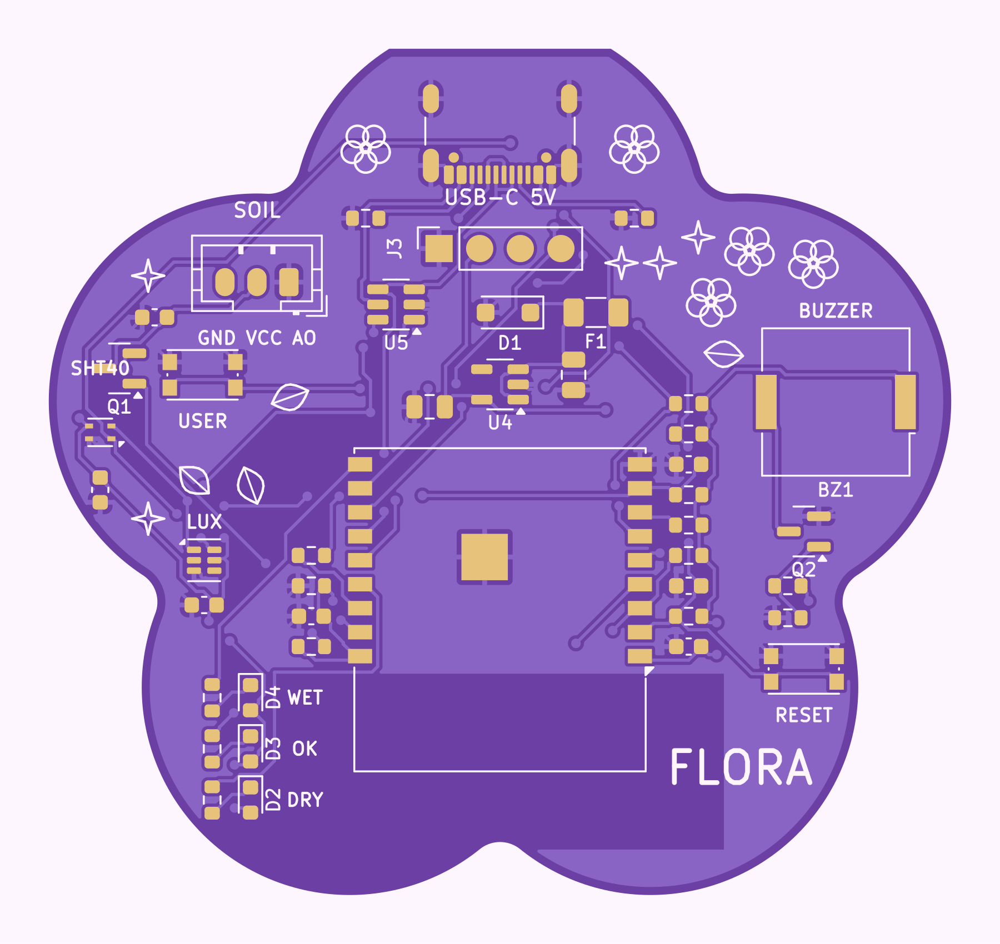

# FLORA — Smart Plant Companion 

Monitor de plantas con **ESP32-C3**, en una **PCB con forma de flor** (5 pétalos, ~56,5 × 53 mm, 2 capas).
Mide humedad del suelo (sonda capacitiva), temperatura y humedad del aire (SHT40) y luz (TSL25911), y lo muestra en una pantalla OLED con LEDs de estado y alerta sonora opcional. Alimentación por USB-C (5 V).

> **Estado honesto del proyecto (v0.1): diseño completo, SIN fabricar y SIN probar en hardware.**
> Los colores de las imágenes son de presentación; el color real de la máscara depende del fabricante.

## Qué hay en este repositorio

| Carpeta | Contenido |
|---|---|
| `hardware/` | Proyecto KiCad 7 (`FLORA.kicad_pro/.kicad_sch/.kicad_pcb`), símbolo propio, BOM, pinout, Gerbers, taladros, posiciones, scripts generadores |
| `firmware/` | Firmware ESP32-C3 (Arduino/PlatformIO) + lógica probada en PC |
| `documentation/` | Arquitectura, diseño eléctrico, guía de montaje, plan de pruebas, BOM, revisión de diseño |
| `manufacturing/` | Notas de fabricación, ensamblaje, checklist de Gerbers y el ZIP listo para el fabricante |
| `renders/` | Vistas superior/inferior (desde los Gerbers), vista de fabricación y modelo STEP de la placa |
| `portfolio/` | Página de caso de estudio (ES/EN) y fragmentos para el portafolio |

## Funciones (v0.1)
Humedad de suelo calibrable (seco/húmedo) · temperatura y HR ambiente · luz · OLED 0,96" · 3 LEDs (seco / OK / exceso) · zumbador desactivable · botón de usuario + reset · umbrales configurables · aviso de sonda desconectada · 10 puntos de prueba · USB-C 5 V (sin PD) · **sin riego automático, sin batería**.

## Verificaciones realizadas y pendientes
| Comprobación | Estado |
|---|---|
| Netlist del esquemático = modelo de diseño (script) | ✅ automática |
| ERC de KiCad | ❌ **no ejecutado** (la CLI de KiCad 7 no lo incluye; hacerlo en el editor) |
| DRC de la PCB (KiCad 7.0.11, API pcbnew) | ✅ 0 errores, 0 pads sin conectar; 1 aviso de serigrafía; 53 avisos de "librería no configurada" (ejecución sin tabla de librerías) |
| Gerbers abiertos con un lector independiente (gerbonara) y revisados visualmente | ✅ |
| Lógica del firmware (pruebas en PC con g++) | ✅ |
| Compilación del firmware para ESP32-C3 | ❌ **no realizada** (hacerla con `pio run` o con el CI) |
| Contraste de pines con hojas de datos | ✅ ESP32-C3-WROOM-02 y TSL25911FN ·  resto solo con símbolos oficiales de KiCad |
| Fabricación, ensamblaje, pruebas físicas | ❌ pendientes (ver `documentation/testing_plan.md`) |

Lista completa de limitaciones: `documentation/design_review.md`.

## Cómo empezar
1. **Fabricar:** envía `manufacturing/FLORA_gerbers_for_fab.zip` y sigue `manufacturing/fabrication_notes.md`.
2. **Comprar:** `hardware/bom.csv` (verifica stock y números de parte antes de pedir).
3. **Montar:** `documentation/assembly_guide.md`.
4. **Firmware:** `firmware/README.md`.
5. **Probar:** `documentation/testing_plan.md`.

## Regenerar el hardware desde cero
Ver `hardware/scripts/README.md` (Python 3, KiCad 7, g++).

## Licencia
MIT (ver `LICENSE`). Cambia la licencia del hardware si lo prefieres (por ejemplo CERN-OHL-P o CC BY 4.0).
